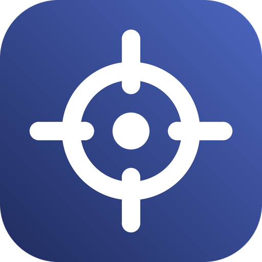

<p align="center">
  
</p>

# Lock On

A **Gundam Card Game deck builder** for **Windows and Android**. Build decks, test opening hands, and keep your phone and computer in sync over your own Wi-Fi. No account or cloud server is required.

[**Download for Windows and Android**](https://github.com/tsunsora/lock-on/releases/latest) · [Changelog](CHANGELOG.md) · [Report an issue](https://github.com/tsunsora/lock-on/issues)

## At a glance

- **The full card list:** one tap downloads every official card and printing, with card images, and a weekly check notes when a newer list is out.
- **Fast deck building:** one tap per copy, live search and filters, and **Max** and **Off-color** tags that show the rules as you build.
- **Deck analysis:** legality messages that name the problem, level and cost curves, Burst and Blocker counts, and Unit–Pilot link pairs.
- **Test hands:** the official setup of draw 5, redraw once, set 6 shields, then draw each turn.
- **Sync without an account:** phones and computers on the same Wi-Fi find each other, and edits reach the other device within seconds.
- **Automatic updates:** new versions download in the background and install with a restart or a tap.
- **A cockpit look:** Material 3 with a mobile-suit colour scheme, dark and light themes, and motion that follows your system's reduced-motion setting.

## Install and start building

### Windows

1. Open the [latest release](https://github.com/tsunsora/lock-on/releases/latest) and download `LockOn-VERSION-windows.msi`.
2. Run it. It installs for your user account only, so no administrator prompt appears, and lets you choose the folder.
3. Launch **Lock On** from the Start menu or desktop shortcut.

The installer bundles its own Java runtime. It isn't code-signed yet, so Windows SmartScreen may say *"Windows protected your PC"*. Choose **More info → Run anyway**. On first launch, allow Lock On through Windows Firewall on **Private networks** so your phone can sync with it.

### Android

Requires **Android 8.0 or newer**.

1. On your phone, download `LockOn-VERSION-android.apk` from the [latest release](https://github.com/tsunsora/lock-on/releases/latest).
2. Open it, and allow your browser or file manager to install apps when Android asks.
3. Open **Lock On**.

### First steps

1. Open **Cards → Catalog** and choose **Download the latest card database**. Until you do, Lock On shows 20 fictional sample cards.
2. In **Decks**, create a deck and add cards from the search panel.
3. To sync, open Lock On on your phone and computer on the same Wi-Fi, then go to **Sync**.

## Everyday use

### Build a deck

- **Add and remove:** tap **+** or **−** on any card in the search results or the deck list. Tap the card itself for details and every printing.
- **Follow the rules as you go:** cards show how many copies are in the deck, **Max** at their copy limit, and **Off-color** when they would add a third color. **Deck colors only** hides the rest.
- **Considering:** park cards you're weighing up in a separate list. It never counts toward deck size, colors or legality, and it syncs and exports with the deck.
- **Drafts are fine:** nothing blocks a save. An incomplete or illegal deck saves as a *Draft*, and the analysis says what's missing.
- **Organize:** duplicate, rename, tag, search and filter decks. Deleting a deck offers **Undo** instead of asking first.

Wide windows show search, the deck and analysis side by side. On phones they become tabs: **Deck**, **Add cards**, **Analysis** and **Test**.

### Keep the card list current

**Cards → Catalog** downloads the official card list from [gcg-api](https://gcgapi.com), about 1,200 cards and 2,000 printings, and converts it on your device. **Check for updates** reads only a small version file, and a weekly background check shows a quiet *Card database update available* in the Cards tab. Card images are cached on each device and can be turned off in the same dialog.

You can also install a catalog from a file or an `https://` link. Every install shows a preview first, including any cards your decks use that the new catalog lacks. Decks are never changed. The format is in [docs/CATALOG_FORMAT.md](docs/CATALOG_FORMAT.md), with a CSV converter in `scripts/`.

### Sync your devices

1. Open Lock On on a phone and a computer on the same Wi-Fi. Each appears in the other's **Nearby** list under **Sync**.
2. Tap **Connect** on either one.
3. Check that both screens show the same 6-digit number, then confirm.

From then on, edits sync within seconds while both apps are open, and the phone follows a computer that changes address. Nothing runs in the background. Phones reach each other through a paired computer. If devices can't see each other, pair by QR code or by typing the computer's address instead.

Only decks sync. Each device keeps its own card list. If the same deck is edited on two devices before they sync, both versions are kept and the deck is marked **Needs review** so you can choose. Deleted decks never come back.

### Import, export and back up

Decks import and export as plain-text lists, by pasting, copying or using a file. A JSON backup saves every deck at once.

### Keyboard shortcuts

| Shortcut | Action |
| --- | --- |
| `Ctrl+F` | Search cards |
| `Esc` | Go back |

## Your data

Everything stays on your devices. Desktop data lives in `%APPDATA%\LockOn` on Windows, and logs are in `%APPDATA%\LockOn\lock-on.log`. Updates keep your decks, and so does uninstalling on Windows. Uninstalling on Android deletes them, so sync or back up first.

Sync uses HTTPS between your own devices, with each device's certificate checked when you pair. Pairing also needs your confirmation on the computer. See [docs/ARCHITECTURE.md](docs/ARCHITECTURE.md) for how decks are stored and synced.

No account, ads or tracking. The internet is used only to download the card list and card images, and to check for app updates.

## Updates

Lock On checks for a new version once a day while it's open. The version and update status are at the bottom of **Sync**.

- **Windows:** the update downloads in the background and installs when you close Lock On. Choose **Restart and update** to install it right away. The installer shows a progress bar, keeps your folder and decks, and reopens Lock On.
- **Android:** the update downloads on Wi-Fi. Tap **Install update** under Sync. The first time, Android asks you to allow installs from Lock On.

Turn off **Update automatically** under Sync to download updates only when you choose. Each download is checked against the checksum published with the release before it's installed.

## Development

Use **JDK 21** (with `jpackage`, for the Windows installer) and the **Android SDK** with platform 36. Point `sdk.dir` in `local.properties` at the SDK.

```sh
git clone https://github.com/tsunsora/lock-on.git
cd lock-on
./gradlew :desktopApp:run
```

| Command | Result |
| --- | --- |
| `./gradlew :desktopApp:run` | Run the desktop app |
| `./gradlew :androidApp:assembleDebug` | Debug APK in `androidApp/build/outputs/apk/debug/` |
| `./gradlew :shared:jvmTest :desktopApp:test` | All tests. Desktop tests also render screenshots to `desktopApp/build/screenshots/` |
| `python scripts/frames_to_gif.py` | GIF previews of the animations, after the desktop tests |
| `./gradlew releaseArtifacts` | Windows MSI, release APK and update feed in `dist/` |

To test sync against yourself, run a second desktop profile with its own data folder:

```sh
./gradlew :desktopApp:run -Plockon.dataDir=/path/to/profile
```

Tests cover the construction rules, deck-list parsing, the revision graph, end-to-end sync between two databases, pairing and sync through the real HTTP routes, and the updater. [RELEASING.md](RELEASING.md) covers versioning, Android signing, publishing a release, and the checklist for real devices.

## Project guide

| Path | Contents |
| --- | --- |
| [`shared/`](shared/) | Kotlin Multiplatform for Android and desktop: models, rules, Room database, sync engine, updater, and every Compose screen |
| [`androidApp/`](androidApp/) | Android entry point, QR scanner, certificate-pinned sync client, Keystore-encrypted token storage, and update installer |
| [`desktopApp/`](desktopApp/) | Desktop entry point, HTTPS sync server, TLS identity, pairing confirmation, and update installer |
| [`docs/`](docs/) | [Architecture](docs/ARCHITECTURE.md), [UX map](docs/UX_MAP.md), [UX rules](docs/UX_RULES.md) and the [catalog format](docs/CATALOG_FORMAT.md) |
| [`scripts/`](scripts/) | Catalog converter, icon and GIF helpers |
| [`licenses/`](licenses/) | Bundled font notice |

Kotlin **2.3.21**, Compose Multiplatform **1.10.3**, AGP **8.13.2** and Gradle **8.14.3** are pinned.

## Credits

An unofficial fan project, unaffiliated with Bandai. Gundam, card text and card images are copyright Bandai. Card images load from Bandai's site and aren't included in Lock On.

Card data comes from [gcg-api](https://gcgapi.com) under the [Open Database License 1.0](https://opendatacommons.org/licenses/odbl/1-0/). Each device downloads it directly; Lock On doesn't host or redistribute it. gcg-api isn't affiliated with Bandai.

The Rajdhani font by the Indian Type Foundry uses the SIL Open Font License 1.1; see the [font notice](licenses/Rajdhani-OFL.txt). Interface icons are Google's Material icons under the Apache 2.0 license. The Lock On mark and other decorations are original drawings.

## Visitors

[](https://count.getloli.com/)

Powered by [Moe Counter](https://github.com/journey-ad/Moe-Counter). This counts README image requests, not unique visitors; GitHub image caching can affect the total.
