<div align="center">

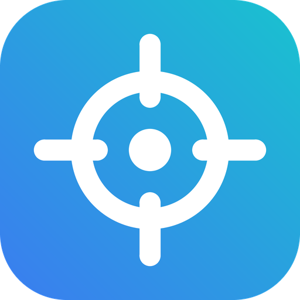

# Lock On

### A Gundam Card Game deck builder for Windows and Android

Build decks, test opening hands, and keep your phone and computer in sync over your own Wi-Fi.<br>
No account, no cloud server, no ads.

[](https://github.com/tsunsora/lock-on/releases/latest)
[](https://github.com/tsunsora/lock-on/releases)
[](#-install)

[](https://kotlinlang.org)
[](https://www.jetbrains.com/compose-multiplatform/)
[](https://github.com/tsunsora/lock-on/commits/main)

**[Download](#-install)** · **[Features](#-features)** · **[Screenshots](#-screenshots)** · **[Guide](#-everyday-use)** · **[Changelog](CHANGELOG.md)** · **[Report an issue](https://github.com/tsunsora/lock-on/issues)**

<br>

<picture>
  <source media="(prefers-color-scheme: light)" srcset="docs/screenshots/desktop-editor-light.png">
  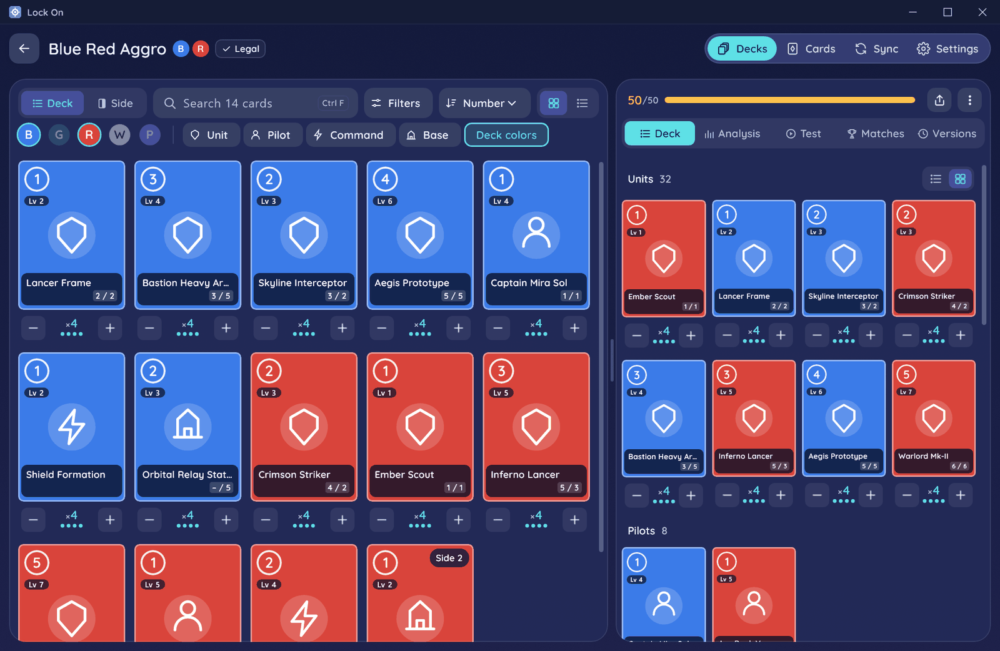
</picture>

</div>

---

## ✨ Features

<table>
<tr>
<td width="50%" valign="top">

### 🃏 The full card list
One tap downloads every official card and printing, with card images. A weekly check notes when a newer list is out.

</td>
<td width="50%" valign="top">

### ⚡ Fast deck building
One tap per copy, live search and filters, and **Max** and **Off-color** tags that show the rules as you build.

</td>
</tr>
<tr>
<td valign="top">

### 📊 Deck analysis
Legality messages that name the problem, level and cost curves, Burst and Blocker counts, and Unit–Pilot link pairs.

</td>
<td valign="top">

### 🎲 Test hands
The official setup: draw 5, redraw once, set 6 shields, then draw each turn.

</td>
</tr>
<tr>
<td valign="top">

### 🗂️ Folders, match log and versions
Group decks into folders, record wins and losses per deck, and compare or restore earlier versions.

</td>
<td valign="top">

### 📤 Share decks
Export a text list, a deck image with a QR code, or a printable deck registration sheet.

</td>
</tr>
<tr>
<td valign="top">

### 🔄 Sync without an account
Phones and computers on the same Wi-Fi find each other. Make one device match the other, or keep them merging so edits arrive within seconds.

</td>
<td valign="top">

### 🎨 A bright game look
Frosted glass over a sky backdrop, card-strip deck lists, copy pips and gauges. Light **Sky** and dark **Twilight** themes, and motion that follows your reduced-motion setting.

</td>
</tr>
</table>

New versions download in the background and install with a restart or a tap.

---

## 📸 Screenshots

<div align="center">

<table>
<tr>
<td align="center">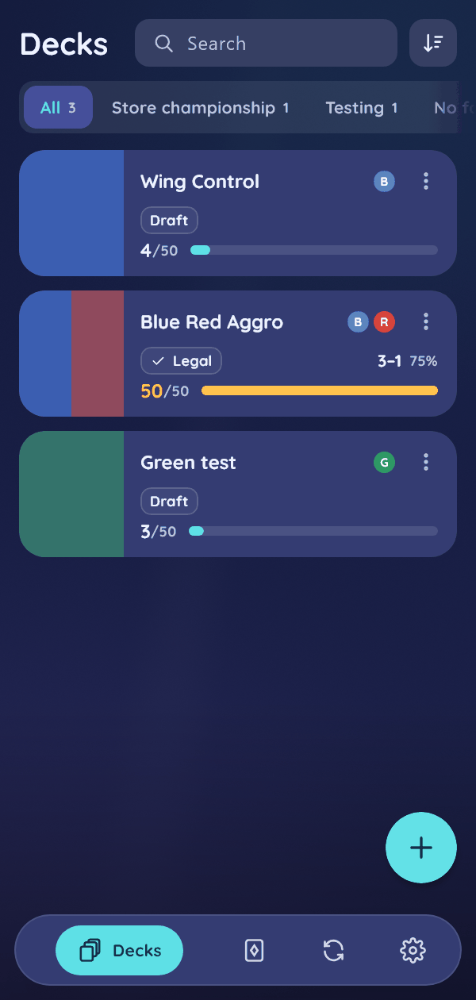<br><sub><b>Your decks</b></sub></td>
<td align="center">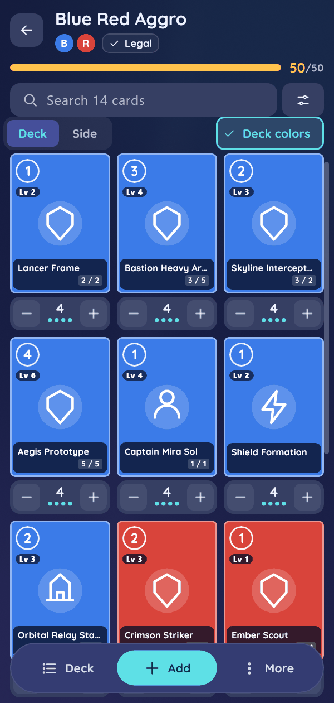<br><sub><b>Deck editor</b></sub></td>
<td align="center">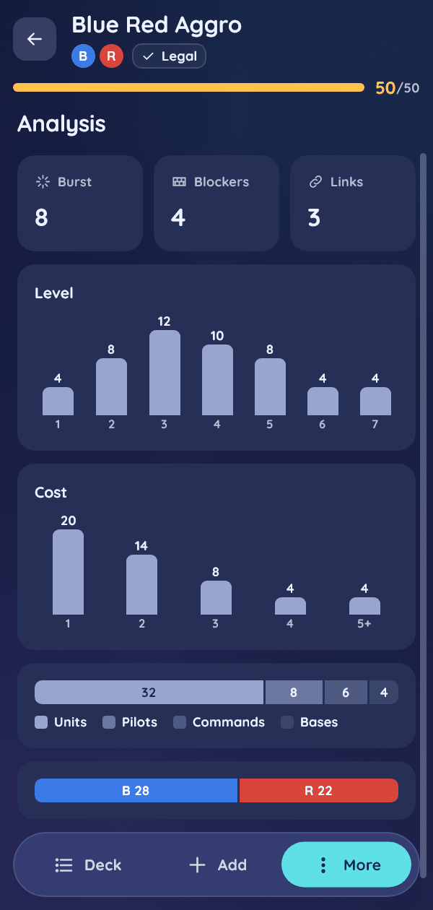<br><sub><b>Analysis</b></sub></td>
<td align="center">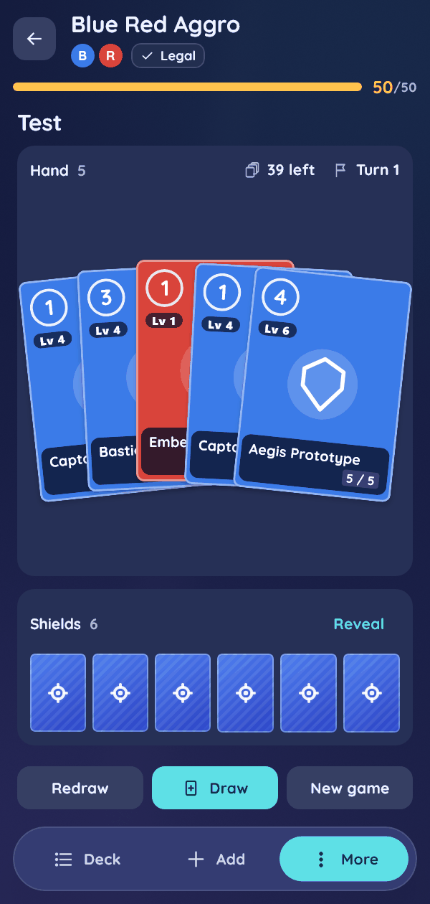<br><sub><b>Test hands</b></sub></td>
</tr>
<tr>
<td align="center">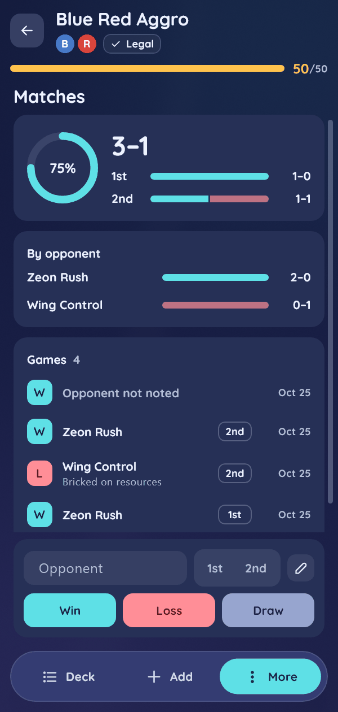<br><sub><b>Match log</b></sub></td>
<td align="center">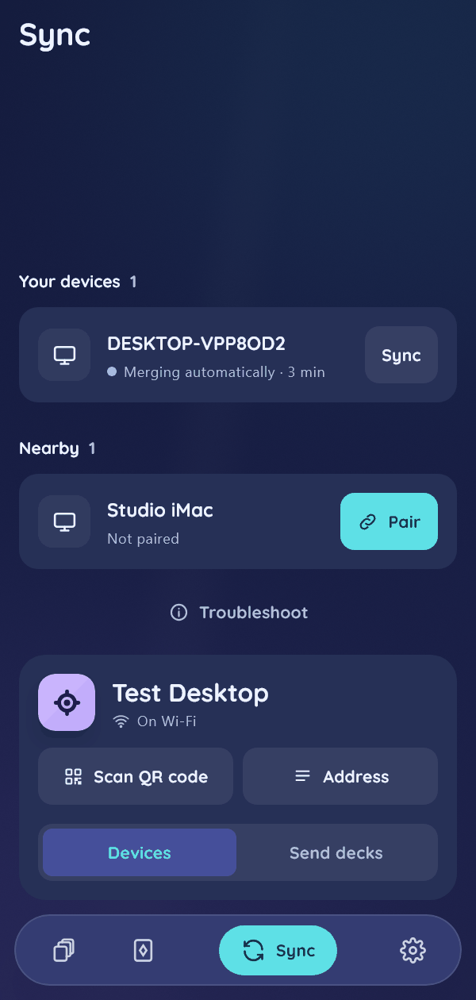<br><sub><b>Device sync</b></sub></td>
<td align="center">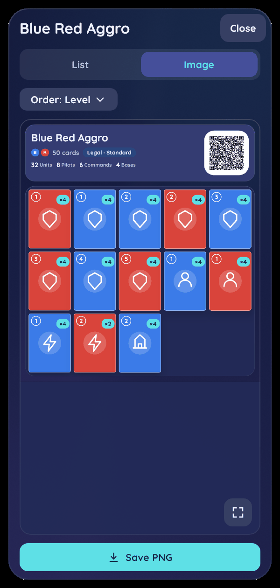<br><sub><b>Deck image export</b></sub></td>
<td align="center">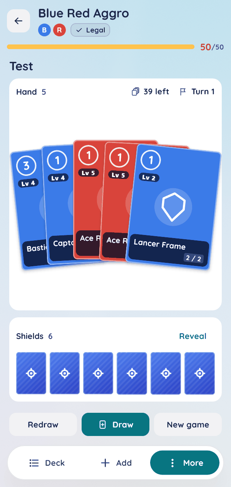<br><sub><b>Sky theme</b></sub></td>
</tr>
</table>

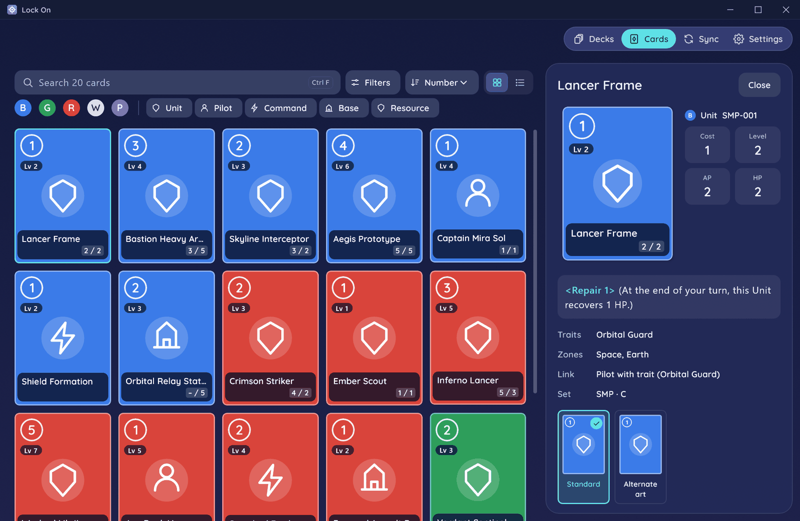
<br><sub><b>Browse every card and printing on the desktop</b></sub>

</div>

<sub>Screenshots use Lock On's built-in sample cards. Real card images are downloaded on each device and aren't part of this repository.</sub>

---

## 📥 Install

<div align="center">

[](https://github.com/tsunsora/lock-on/releases/latest)
&nbsp;
[](https://github.com/tsunsora/lock-on/releases/latest)

</div>

<table>
<tr>
<td width="50%" valign="top">

#### 🪟 Windows

1. Open the [latest release](https://github.com/tsunsora/lock-on/releases/latest) and download `LockOn-VERSION-windows.msi`.
2. Run it. It installs for your user account only, so no administrator prompt appears, and lets you choose the folder.
3. Launch **Lock On** from the Start menu or desktop shortcut.

</td>
<td width="50%" valign="top">

#### 🤖 Android

Requires **Android 8.0 or newer**.

1. On your phone, download `LockOn-VERSION-android.apk` from the [latest release](https://github.com/tsunsora/lock-on/releases/latest).
2. Open it, and allow your browser or file manager to install apps when Android asks.
3. Open **Lock On**.

</td>
</tr>
</table>

> [!NOTE]
> The Windows installer bundles its own Java runtime. It isn't code-signed yet, so Windows SmartScreen may say *"Windows protected your PC"*. Choose **More info → Run anyway**. On first launch, allow Lock On through Windows Firewall on **Private networks** so your phone can sync with it.

### 🚀 First steps

1. Choose **Download card database** in the welcome tour, or later under **Settings → Card database → Manage card database**. Until you do, Lock On shows 20 fictional sample cards.
2. In **Decks**, create a deck and add cards from the search panel.
3. To sync, open Lock On on your phone and computer on the same Wi-Fi, then go to **Sync**.

---

## 📖 Everyday use

<details>
<summary><b>🛠️ Build a deck</b></summary>

<br>

- **Add and remove:** tap **+** or **−** on any card in the search results or the deck list. Tap the card itself for details and every printing.
- **Follow the rules as you go:** cards show how many copies are in the deck, **Max** at their copy limit, and **Off-color** when they would add a third color. **Deck colors only** hides the rest.
- **Side deck:** keep cards beside the deck. Switch the card list to **Add to: Side deck** and add them like any other card. It never counts toward deck size, colors or legality, and it syncs and exports with the deck.
- **Drafts are fine:** nothing blocks a save. An incomplete or illegal deck saves as a *Draft*, and the analysis says what's missing.
- **Organize:** duplicate, rename, tag, search and filter decks. Deleting a deck offers **Undo** instead of asking first.
- **Folders:** the desktop shows a folder list beside your decks, and phones show folder chips. Create a folder, empty or with its decks picked in the same step, use **Move to folder** from a deck's menu or drag a deck onto a folder, and rename or remove a folder. Removing a folder only takes its decks out. Folders sync.
- **Deck cover:** open a card's details in the editor and choose **Use as deck cover**. Otherwise the deck shows its highest-level Unit.

Wide windows give most of the space to the card list and the deck. The deck panel has **Deck**, **Analysis**, **Test**, **Matches** and **Versions** tabs, and the Deck tab opens with a summary of the curve, card types and any legality problem. The deck shows its cards small and whole, or as a denser list. On phones they sit in a bottom bar: **Deck**, **Add**, **Analysis**, **Test**, and **More** for Matches and Versions.

</details>

<details>
<summary><b>🏆 Track results and versions</b></summary>

<br>

- **Matches:** log each game as a win, loss or draw in one tap, with an optional opponent, turn order and note. The tab shows your record, win rate, results going first and second, and results by opponent. The library shows each deck's record.
- **Versions:** every version of a deck, with what changed. Open an older one to compare it with the deck now and restore its cards. Your edits join the current version until you choose **Keep as a version**, it syncs, or the deck sits for 30 minutes.

</details>

<details>
<summary><b>🃏 Keep the card list current</b></summary>

<br>

**Download card database** (in the welcome tour, or **Settings → Card database → Manage card database**) downloads the official card list from [gcg-api](https://gcgapi.com), about 1,200 cards and 2,000 printings, and converts it on your device. Alt arts that are already on Bandai's official card list but not yet in gcg-api's weekly refresh are added from Bandai's site. **Check for updates** reads only a small version file, and a weekly background check shows a quiet *Card database update available* under **Settings → Card database**. Card images are cached on each device and can be turned off with **Settings → Show card artwork**.

You can also install a catalog from a file or an `https://` link. Every install shows a preview first, including any cards your decks use that the new catalog lacks. Decks are never changed. The format is in [docs/CATALOG_FORMAT.md](docs/CATALOG_FORMAT.md), with a CSV converter in `scripts/`.

</details>

<details>
<summary><b>🔄 Sync your devices</b></summary>

<br>

1. Open Lock On on a phone and a computer on the same Wi-Fi, and go to **Sync** → **Sync devices**. Each appears in the other's **Nearby** list.
2. Tap the other device, check that both screens show the same 6-digit number, then confirm.
3. Choose which way to sync:
   - **Make this phone match the computer**, or **Make the computer match this phone**. Everything on the device being replaced is swapped for the other's: decks with their history, folders (empty ones too), match logs, settings, the chosen ruleset and the card list. Decks only on that device are removed; earlier versions of replaced decks stay in their history. Lock On asks once more before replacing anything.
   - **Merge both ways** keeps every deck from both instead, and leaves settings and the card list alone. If the same deck was edited on both, both versions are kept and the deck is marked **Needs review**. On a phone, **Keep merging** makes edits merge within seconds whenever both apps are open.

Either device can start a sync. A sync started on the computer is carried out by the phone, so Lock On must be open on it, and the phone asks before its own decks are replaced. Nothing runs in the background, and the phone follows a computer that changes address. Phones reach each other through a paired computer. If devices can't see each other, pair by QR code or by typing the computer's address instead (**+** next to Your devices).

Card pictures aren't copied; each device downloads its own. Device names and pairings stay with each device.

To hand someone a few decks without pairing, use **Sync** → **Send decks**: they arrive as new copies, and the other device is asked first.

</details>

<details>
<summary><b>📤 Import, export and back up</b></summary>

<br>

Decks import and export as plain-text lists, by pasting, copying or using a file. A JSON backup saves every deck at once.

A deck's **Export** dialog also saves a 2160-pixel-wide **image** of the deck (PNG), five cards to a row so each card is readable, and a **print sheet**: a deck registration sheet saved as a web page that you can print from any browser. The image shows the main deck with each card's count under it, the level curve and type counts, and a QR code that holds the whole deck list: anyone can scan it with a phone camera and paste the text into **Import**. Choose the card order for all three formats: by level (the default), cost, card number, name or copies. Every order lists all the Units first, then Pilots, Commands and Bases.

</details>

<details>
<summary><b>⌨️ Keyboard shortcuts</b></summary>

<br>

| Shortcut | Action |
| --- | --- |
| `Ctrl+F` | Search cards |
| `Esc` | Go back |

</details>

---

## 🔒 Your data

Everything stays on your devices. Desktop data lives in `%APPDATA%\LockOn` on Windows, and logs are in `%APPDATA%\LockOn\lock-on.log`. Updates keep your decks, and so does uninstalling on Windows.

> [!WARNING]
> Uninstalling on Android deletes your decks, so sync or back up first.

Sync uses HTTPS between your own devices, with each device's certificate checked when you pair. Pairing also needs your confirmation on the computer. See [docs/ARCHITECTURE.md](docs/ARCHITECTURE.md) for how decks are stored and synced.

No account, ads or tracking. The internet is used only to download the card list and card images, and to check for app updates.

## ⬆️ Updates

Lock On checks for a new version once a day while it's open. The version and update status are at the bottom of **Settings**.

- **Windows:** the update downloads in the background and installs when you close Lock On. Choose **Restart and update** to install it right away. The installer shows a progress bar, keeps your folder and decks, and reopens Lock On.
- **Android:** the update downloads on Wi-Fi. Tap **Install update** under Settings. The first time, Android asks you to allow installs from Lock On.

Turn off **Update automatically** under Settings to download updates only when you choose. Each download is checked against the checksum published with the release before it's installed.

---

## 🧑‍💻 Development

Use **JDK 21** (with `jpackage`, for the Windows installer) and the **Android SDK** with platform 36. Point `sdk.dir` in `local.properties` at the SDK.

```sh
git clone https://github.com/tsunsora/lock-on.git
cd lock-on
./gradlew :desktopApp:run
```

| Command | Result |
| --- | --- |
| `./gradlew :desktopApp:run` | Run the desktop app |
| `./gradlew :androidApp:assembleDebug` | Debug APK in `androidApp/build/outputs/apk/debug/` |
| `./gradlew :shared:jvmTest :desktopApp:test` | The tests, without the slow image renders |
| `./gradlew :desktopApp:previews` | Renders screenshots to `desktopApp/build/screenshots/` and animation frames. Slow, so pick some with `--tests '*ScreenshotTest.renderDeviceSync'` |
| `python scripts/frames_to_gif.py` | GIF previews of the animations, after the desktop tests |
| `./gradlew releaseArtifacts` | Windows MSI, release APK and update feed in `dist/` |

To test sync against yourself, run a second desktop profile with its own data folder:

```sh
./gradlew :desktopApp:run -Plockon.dataDir=/path/to/profile
```

Tests cover the construction rules, deck-list parsing, the revision graph, end-to-end sync between two databases, pairing and sync through the real HTTP routes, and the updater. [RELEASING.md](RELEASING.md) covers versioning, Android signing, publishing a release, and the checklist for real devices. The README's pictures live in [`docs/screenshots/`](docs/screenshots/) and come from the `previews` renders.

<details>
<summary><b>🗺️ Project guide</b></summary>

<br>

| Path | Contents |
| --- | --- |
| [`shared/`](shared/) | Kotlin Multiplatform for Android and desktop: models, rules, Room database, sync engine, updater, and every Compose screen |
| [`androidApp/`](androidApp/) | Android entry point, QR scanner, certificate-pinned sync client, Keystore-encrypted token storage, and update installer |
| [`desktopApp/`](desktopApp/) | Desktop entry point, HTTPS sync server, TLS identity, pairing confirmation, and update installer |
| [`docs/`](docs/) | [Architecture](docs/ARCHITECTURE.md), [UX map](docs/UX_MAP.md), [UX rules](docs/UX_RULES.md), the [catalog format](docs/CATALOG_FORMAT.md) and README screenshots |
| [`scripts/`](scripts/) | Catalog converter, icon and GIF helpers |
| [`licenses/`](licenses/) | Bundled font notice |

Kotlin **2.3.21**, Compose Multiplatform **1.10.3**, AGP **8.13.2** and Gradle **8.14.3** are pinned.

</details>

---

## 🙏 Credits

An unofficial fan project, unaffiliated with Bandai. Gundam, card text and card images are copyright Bandai. Card images load from Bandai's site and aren't included in Lock On.

Card data comes from [gcg-api](https://gcgapi.com) under the [Open Database License 1.0](https://opendatacommons.org/licenses/odbl/1-0/). Each device downloads it directly; Lock On doesn't host or redistribute it. gcg-api isn't affiliated with Bandai. Alt arts not yet in gcg-api are read from Bandai's official card list on each device.

The Quicksand font by the Quicksand Project Authors uses the SIL Open Font License 1.1; see the [font notice](licenses/Quicksand-OFL.txt). Interface icons are Google's Material icons under the Apache 2.0 license. The Lock On mark and other decorations are original drawings.

## 👀 Visitors

<div align="center">

[](https://count.getloli.com/)

<sub>Powered by [Moe Counter](https://github.com/journey-ad/Moe-Counter). This counts README image requests, not unique visitors; GitHub image caching can affect the total.</sub>

</div>
