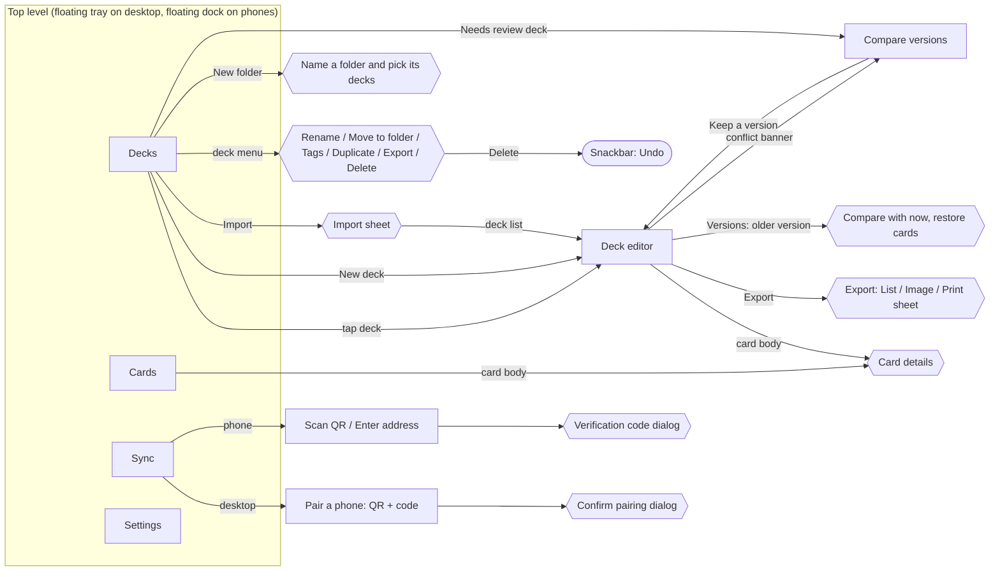

# Lock On UX map

How screens connect, what each one is for, and what you can do there. The rules every screen follows are in [UX_RULES.md](UX_RULES.md).

## Map

Rectangles are screens. Hexagons are sheets or dialogs that sit over the current screen. N2 forbids a third screen level, so anything deeper must be one of these.

## Screens

### Decks (top level)
- **Purpose:** find a deck and start working on it.
- **Shows:** each deck as a tile with its cover card (the one picked in the editor, else its highest-level Unit, or a card back for an empty deck), a color-identity band, name, Legal / Draft / Needs review tag, `Main n/50`, its folder, tags, win/loss record, and when it was last edited. On desktop the tiles form a grid.
- **Folders:** a list beside the decks on desktop (**All decks**, each folder with its count, **No folder**, **New folder**), a chip row on phones. A folder is a filter, not a screen (N2).
  - **New folder** names the folder and can put decks in it in the same step; picking none makes an empty folder. A folder stays, even empty, until it is removed.
  - **Rename** and **Remove folder** are on the folder: its ⋮ button on hover or a right-click in the desktop list, a right-click on a phone chip, and the **More actions** menu while the folder is open. Removing asks first, says how many decks it holds, then only takes its decks out, with Undo.
  - **New deck** inside a folder puts the deck in it.
  - Drag a deck onto a folder, or onto **No folder**, to move it, with Undo. A mouse drags at once; a finger holds the deck first so the list still scrolls. Dropping on **New folder** opens it with that deck ticked.
  - Folders sync with the decks.
- **Actions:**
  - Bottom right: **New deck**.
  - Top: **Import** and **Back up all**.
  - Search decks by name, and filter by folder and tag.
  - Each tile's menu: Rename, Move to folder (pick a folder in use, or type a new one), Edit tags, Duplicate (keeps folder and cover, not matches), Export, Delete (with Undo).
- **Empty state:** explains the three ways to get a deck: create one, import one, or pair a device.

### Deck editor (level 2)
- **Header:**
  - name (tap to rename), color pips, legality tag, `Main n/50`
  - **Export**
  - a conflict banner when one exists
- **Panes:** wide windows show two areas, the card list and a deck panel with **Deck · Analysis · Test · Matches · Versions** tabs. Phones show them in a bottom bar built around building the deck: **Deck · Add cards · More**, with Analysis, Test, Matches and Versions under More:
  1. **Add cards:** catalog search with filters, as a grid of whole cards (3 across on phones), with the deck count, outline and − / + under each card.
     - **Add to: Deck · Side deck** above the list picks where + and dropped cards go.
     - Each card shows its in-deck count and − / +, and gets **Max** at the copy limit and **Off-color** when it would add a third color. Adding to the side deck, the counts are side deck copies, and a card already in the deck is tagged **Deck n**.
     - **Deck colors only** narrows the list to the deck's colors.
     - Sort by number, level, cost or name.
  2. **Deck:** grouped by type (Units, Pilots, Commands, then Bases), each with a HUD header and count, sorted by level and then cost, with − / + on every row.
     - On phones a fixed bar above the list holds the level curve (opens Analysis), a chip per section with its count that jumps to it, **List / Cards**, and the first legality problem. An empty deck offers **Add cards**.
     - The **Side deck** comes after the deck, never counted toward size, colors or legality. Each row has **To deck** (moves one copy in) and − / +.
     - Card details have a side deck − / +, and **Move 1 to side deck** or **Move 1 to deck**, depending on where the card already is.
     - In the card list, a card with side deck copies is tagged **Side n**.
     - Card details also offer **Use as deck cover**.
     - Notes go at the end.
  3. **Analysis:**
     - legality messages first
     - Gundam readouts: Burst cards (how many can trigger from shields), Blockers, and Unit–Pilot link pairs present
     - level curve, cost curve, type and color counts
  4. **Test (sample hand):**
     - Shuffle and draw 5, with one **Redraw** that follows the official rule.
     - The next 6 cards become shields, face down until you reveal them.
     - **Draw** adds one card per turn.
     - **New game** shuffles again.
     - Stats show how many Units of level 2 or lower are in hand.
  5. **Matches (win/loss log):**
     - record, win rate, and results going first and second
     - **Log a match:** an optional opponent (picked from earlier opponents or typed), turn order and note, then **Win**, **Loss** or **Draw** logs it in one tap
     - results by opponent, then every game, newest first, each removable with Undo
     - Matches sync. When a conflict is settled, games logged on every device are kept.
  6. **Versions:**
     - Every version newest first, with time, device, counts and what changed (`+3 −1 cards · renamed`).
     - Edits join the current version until you choose **Keep as a version**, it syncs, or the deck sits for 30 minutes.
     - Opening an older version lists its card differences from now, and **Restore these cards** brings them back with Undo. Name, notes, folder and matches stay as they are.
- **Export dialog:** **List** (copy or save the text list), **Image** (a 2160-pixel-wide picture of the main deck, five cards a row, with its cover, colors, legality, curve, type counts and a QR code holding the list, saved as PNG), and **Print sheet** (a deck registration sheet saved as a web page to print from any browser). On wide windows the preview sits beside the controls and shows the whole image at once (**View: Full width** zooms it to scroll); on phones the dialog fills the screen and the preview takes every row the controls leave.
- **Leaving:** back or the navigation, which saves first.

### Compare versions (level 2)
- **Purpose:** settle a deck that was edited on two devices before they synced.
- **Shows:** one card per version, with the device, time, name, counts and per-card differences.
- **Action:** **Keep this version**, or **Delete the deck** if one side deleted it. This returns to the editor.

### Cards (top level)
- **Purpose:** browse and learn cards outside any deck.
- **Shows:** a search field with the card count, then one chip row (results, Filters, Sort, Grid/List, colors, types), as a gallery of whole cards or a list. On desktop, tapping a card opens its details in a side panel; on phones, in a dialog.
- **Card details:** artwork when the catalog has it (tap a printing to switch art), type and stats, corrected text, traits, zones, link, and printings.
- The catalog is managed from **Settings → Card database**, not from here, so the header has no actions.

**Settings → Card database** shows the installed catalog and, when a weekly background check finds a newer official list, a quiet *Card database update available* line (UX rule C1: no pop-up). **Manage card database** opens a dialog that:
  - shows the installed catalog: name, version, card count, where it came from, and when it was installed
  - has a **Show card artwork** switch (images are cached per device and never sync)
  - **Official card list:** **Download card database** (gcg-api, converted on the device), then **Check for updates** / **Download update**, with the gcg-api credit underneath
  - **Other sources:** an `https://` link to **Download**, then later **Check for update**, or **Import file**
  - offers **Restore sample**
  - always shows a preview before installing: an update or a replacement, warnings, and any cards your decks use that the new catalog lacks. **Update** / **Replace catalog** confirms, since this can't be undone (C2).

### Sync (top level)
- **Send decks** (both devices, first after the status line), LocalSend-style:
  - **Choose decks** opens a checklist of decks. The chosen names show on the card, with **Change**.
  - Every Lock On device nearby is listed, paired or not (phones on a computer, computers on a phone), each with **Send**.
  - While the other device decides, the row reads *Waiting for Pixel to accept…* with **Cancel**. Then it reads *Pixel saved 2 decks.*, *Pixel declined.*, or why it failed.
  - The receiver sees *"Desk wants to send you 2 decks"*, listing each deck and its main deck count, with **Accept** or **Decline**. Accepted decks are added as new decks with their cards, notes, tags and cover. Folders and match logs stay with the sender.
- **Desktop:**
  - **Nearby phones:** every phone with Lock On open on the network, each with **Connect** (an invitation the phone accepts) or *Waiting for the phone… Cancel*. Paired phones are marked.
  - **Other ways to connect:** the QR code, address, port, pairing code and code expiry, shown by default only until a phone is paired
  - paired phones with their last successful sync, and *Connected now* while a phone's auto-sync is live
  - a dialog to confirm a pairing request: *"Pixel wants to connect"* or *"Pixel accepted"*, with the 6-digit number to compare
- **Phone:**
  - **Auto-sync while Lock On is open** switch (on by default), once a desktop is paired
  - **Nearby computers** found on the network, each with **Connect** (no code to type; the computer confirms after comparing the 6-digit number)
  - *"[Computer] wants to connect"* when a computer invites this phone, with **Connect** or **Not now**
  - **Other ways to connect** (collapsed): **Scan QR code**, or address, port and an optional code
  - paired desktops with **Sync now**, last sync, the last manual-sync error, and a live line: *Live: changes sync automatically* or *Waiting for the desktop*
  - a verification code dialog while the desktop is confirming
- **Always:** the line "Only decks sync. No account or cloud server."
- A dot on the Sync tab is the only sync signal outside this screen (C1).

### Settings (top level, beside Sync)
- **Purpose:** this device's preferences. They are stored on the device and never sync.
- **Appearance:** **Theme** (Match system · Sky · Twilight), **Interface size** (Small · Default · Large · Larger, scaling everything together), **Animations** (Match system · Reduced · Full).
- **Startup:** **Open on** Decks, Cards, or *Where I left off*.
- **Cards:** **Show card artwork** and **Check for card list updates** (the weekly background check) switches, then the card database card with **Manage card database**.
- **This device:** the name paired devices see, with **Rename** (used from the next launch).
- **App updates** last.

## Primary journeys

1. **First deck on a phone:**
   1. Decks → **New deck** → name it.
   2. Editor opens on **Add cards**.
   3. Tap + until the header reads `Main 50/50`.
   4. Switch to **Test** to try hands.
   5. Back. It's already saved.
2. **Import a list from a friend:**
   1. Decks → **Import** → paste.
   2. The editor opens on the imported deck, with any unreadable lines reported.
3. **Phone to computer (first time), LocalSend-style:**
   1. Open Lock On on both, on the same Wi-Fi. Each appears in the other's **Nearby** list.
   2. Tap **Connect** on either device. If the computer started it, tap **Connect** on the phone too.
   3. The computer shows a 6-digit number, and so does the phone. If they match, click **Pair**.
   4. Sync starts at once and stays automatic while both are open.
   - Fallback when discovery is blocked:
   1. Desktop: **Sync**, which shows the QR code.
   2. Phone: **Sync** → **Scan QR code**.
   3. Desktop: confirm the codes match → **Pair**.
   4. The phone syncs right away.
   5. With both open, edits on either device appear on the other within seconds. **Sync now** is there when auto-sync is off.
   - Or, without the camera: the desktop shows under **Nearby desktops** on the phone → **Pair** → type the code.
4. **Edited on both devices:**
   1. The deck tile shows **Needs review**.
   2. Open **Compare versions** → **Keep this version** → back in the editor.
5. **Give a friend a deck:**
   1. Both open Lock On on the same Wi-Fi and go to **Sync**.
   2. **Choose decks**, tick the decks, **Done**.
   3. Tap **Send** beside the friend's device. No pairing needed.
   4. The friend taps **Accept**, and the decks appear in their library as new decks.
6. **Remove a deck by mistake:** Delete → **Undo** in the snackbar.
7. **Build a side deck:**
   1. Set the card list to **Add to: Side deck**, then + or drag cards in. Or open a card → side deck +, or **Move 1 to side deck** if it's already in the deck.
   2. It waits under Side deck without affecting legality.
   3. **To deck** brings a copy into the deck.
   4. Exported lists carry a `// Side deck` section; older lists with `// Considering` read back into it.
