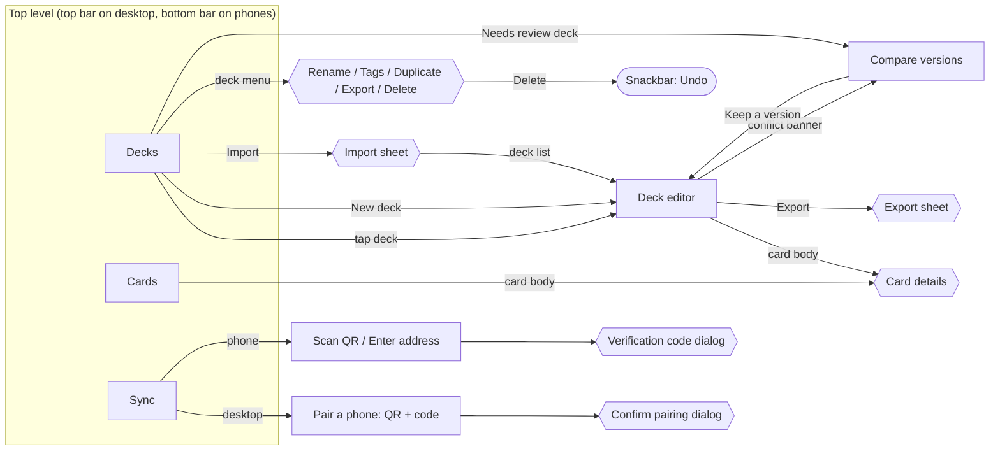

# Lock On UX map

How screens connect, what each one is for, and what you can do there. The rules every screen follows are in [UX_RULES.md](UX_RULES.md).

## Map

Rectangles are screens. Hexagons are sheets or dialogs that sit over the current screen. N2 forbids a third screen level, so anything deeper must be one of these.

## Screens

### Decks (top level)
- **Purpose:** find a deck and start working on it.
- **Shows:** each deck as a chamfered tile with a color-identity band, name, Legal / Draft / Needs review tag, `Main n/50 · Resource n/10`, tags, and when it was last edited.
- **Actions:**
  - Bottom right: **New deck**.
  - Top: **Import** and **Back up all**.
  - Search decks by name, and filter by tag.
  - Each tile's menu: Rename, Edit tags, Duplicate, Export deck list, Delete (with Undo).
- **Empty state:** explains the three ways to get a deck: create one, import one, or pair a device.

### Deck editor (level 2)
- **Header:**
  - name (tap to rename), color pips, legality tag, `Main n/50 · Resource n/10`
  - **Export**
  - a conflict banner when one exists
- **Panes**, shown side by side on wide windows and as tabs on phones (**Deck · Add cards · Analysis · Test**):
  1. **Add cards:** catalog search with filters.
     - Each card shows its in-deck count and − / +, and gets **Max** at the copy limit and **Off-color** when it would add a third color.
     - **Deck colors only** narrows the list to the deck's colors.
     - Sort by number, level, cost or name.
  2. **Deck:** grouped by type (Units, Pilots, Commands, Bases, then Resources), each with a HUD header and count, sorted by level and then cost, with − / + on every row.
     - **Considering** comes after Resources: cards you're weighing up, never counted toward size, colors or legality. Each row has **To deck** (moves one copy in) and − (drops one).
     - Card details offer **Consider**, **Move 1 to Considering** or **Move 1 to deck**, depending on where the card already is.
     - In the card list, a card that is only being considered is tagged **Considering**.
     - Notes go at the end.
  3. **Analysis:**
     - legality messages first
     - Gundam readouts: Burst cards (how many can trigger from shields), Blockers, and Unit–Pilot link pairs present
     - level curve, cost curve, type and color counts
  4. **Test (sample hand):**
     - Shuffle and draw 5, with one **Redraw** that follows the official rule.
     - The next 6 cards become shields, face down until you reveal them.
     - **Draw** adds one card per turn.
     - **New game** shuffles again.
     - Stats show how many Units of level 2 or lower are in hand.
- **Leaving:** back or the navigation bar, which saves first.

### Compare versions (level 2)
- **Purpose:** settle a deck that was edited on two devices before they synced.
- **Shows:** one card per version, with the device, time, name, counts and per-card differences.
- **Action:** **Keep this version**, or **Delete the deck** if one side deleted it. This returns to the editor.

### Cards (top level)
- **Purpose:** browse and learn cards outside any deck.
- **Shows:** a search field, color and type chips, and more filters (level, cost, set, trait), as a list or grid with the result count.
- **Card details:** artwork when the catalog has it (tap a printing to switch art), type and stats, corrected text, traits, zones, link, and printings.
- **Catalog** (button next to the catalog name) opens a dialog that:
  - shows the installed catalog: name, version, card count, where it came from, and when it was installed
  - has a **Show card artwork** switch (images are cached per device and never sync)
  - takes an `https://` link to **Download**, then later **Check for update**, or **Import file**
  - offers **Go back to the sample catalog**
  - always shows a preview before installing: an update or a replacement, warnings, and any cards your decks use that the new catalog lacks. **Update** / **Replace catalog** confirms, since this can't be undone (C2).

### Sync (top level)
- **Desktop:**
  - a pairing card with the QR code, address, port, pairing code, verification code and code expiry
  - paired phones with their last successful sync, and *Connected now* while a phone's auto-sync is live
  - a dialog to confirm a pairing request
- **Phone:**
  - **Auto-sync while Lock On is open** switch (on by default), once a desktop is paired
  - **Nearby desktops** found on the network, each with **Pair**, which asks only for the pairing code
  - **Scan QR code** and **Enter address**
  - paired desktops with **Sync now**, last sync, the last manual-sync error, and a live line: *Live: changes sync automatically* or *Waiting for the desktop*
  - a verification code dialog while the desktop is confirming
- **Always:** the line "Only decks sync. No account or cloud server."

## Primary journeys

1. **First deck on a phone:**
   1. Decks → **New deck** → name it.
   2. Editor opens on **Add cards**.
   3. Tap + until the header reads `Main 50/50`.
   4. Switch to **Test** to try hands.
   5. Back. It's already saved.
2. **Import a list from a friend:**
   1. Decks → **Import** → paste.
   2. The editor opens on the imported deck, with any unreadable lines reported.
3. **Phone to desktop (first time):**
   1. Desktop: **Sync**, which shows the QR code.
   2. Phone: **Sync** → **Scan QR code**.
   3. Desktop: confirm the codes match → **Pair**.
   4. The phone syncs right away.
   5. With both open, edits on either device appear on the other within seconds. **Sync now** is there when auto-sync is off.
   - Or, without the camera: the desktop shows under **Nearby desktops** on the phone → **Pair** → type the code.
4. **Edited on both devices:**
   1. The deck tile shows **Needs review**.
   2. Open **Compare versions** → **Keep this version** → back in the editor.
5. **Remove a deck by mistake:** Delete → **Undo** in the snackbar.
6. **Not sure about a card:**
   1. Open the card → **Consider**, or **Move 1 to Considering** if it's already in the deck.
   2. It waits under Considering without affecting legality.
   3. **To deck** brings a copy back in.
   4. Exported lists carry a `// Considering` section.
